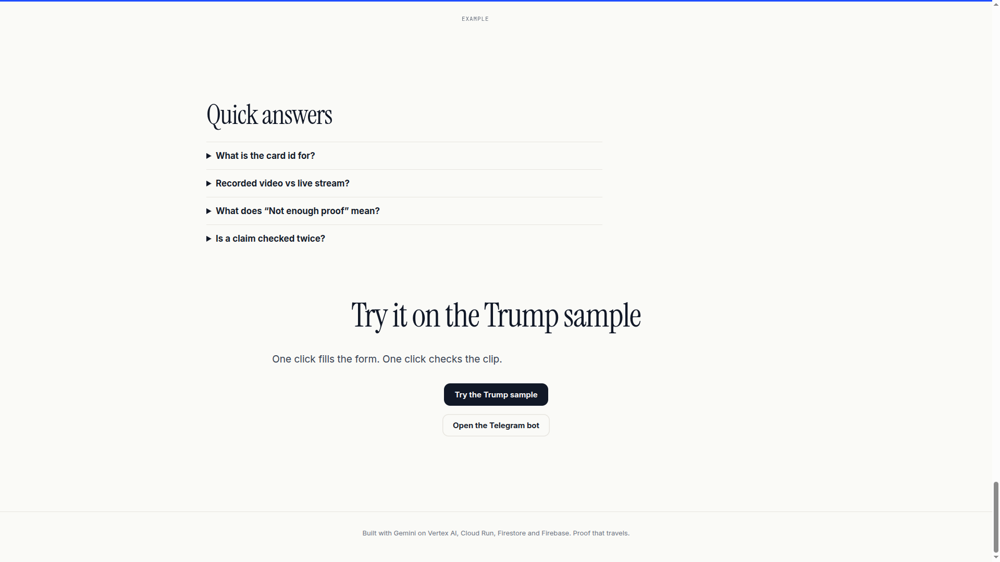
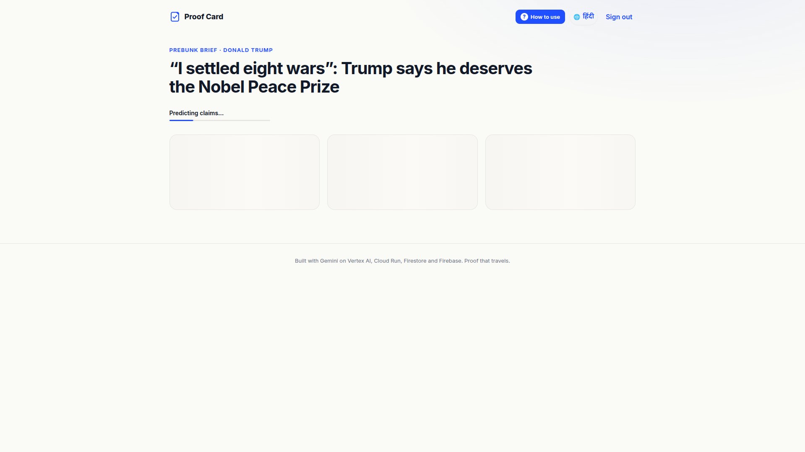
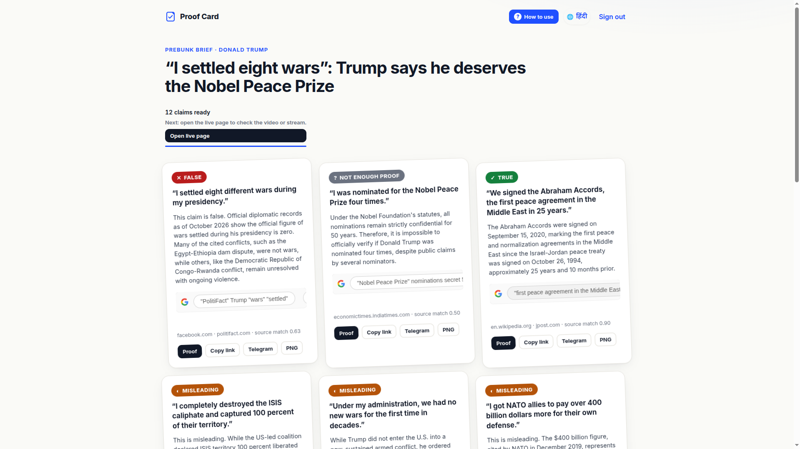
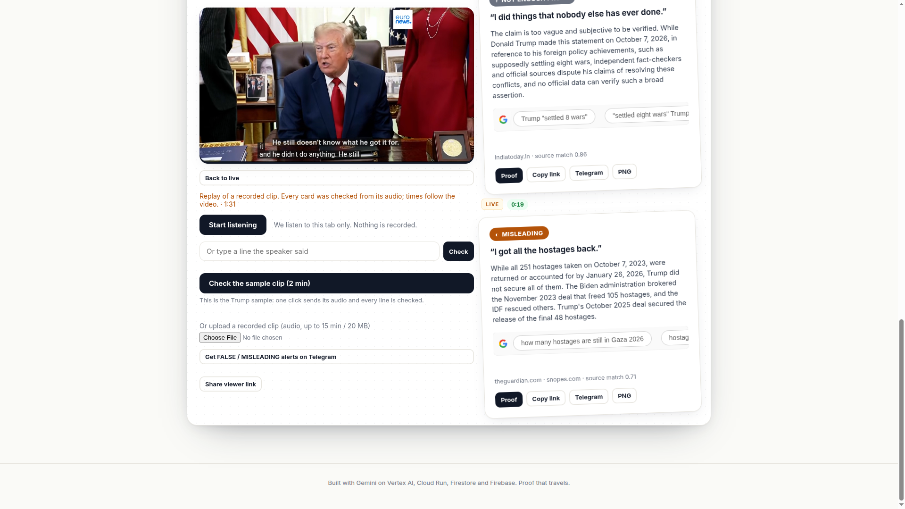
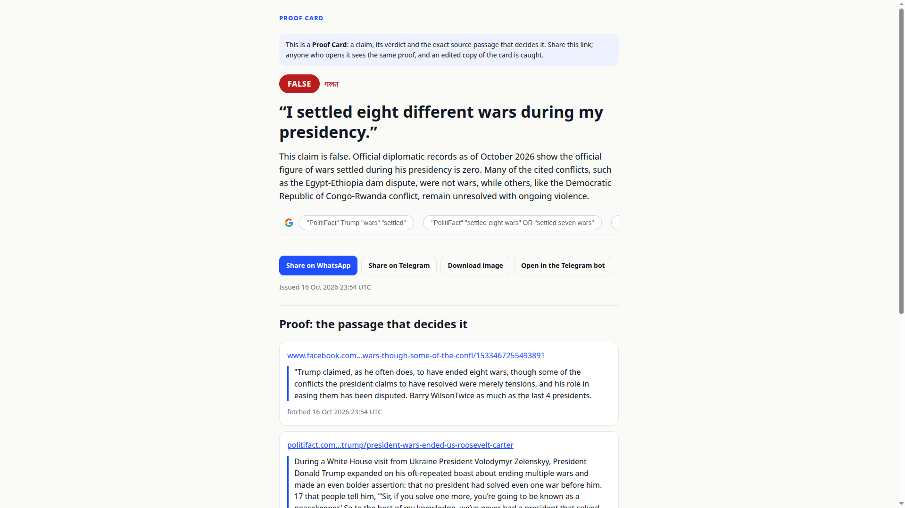
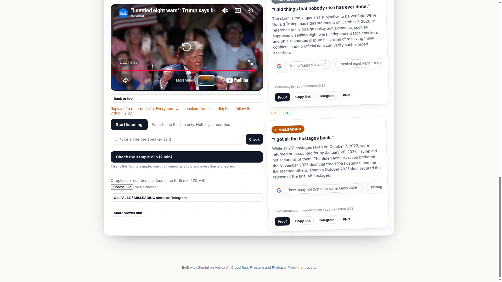
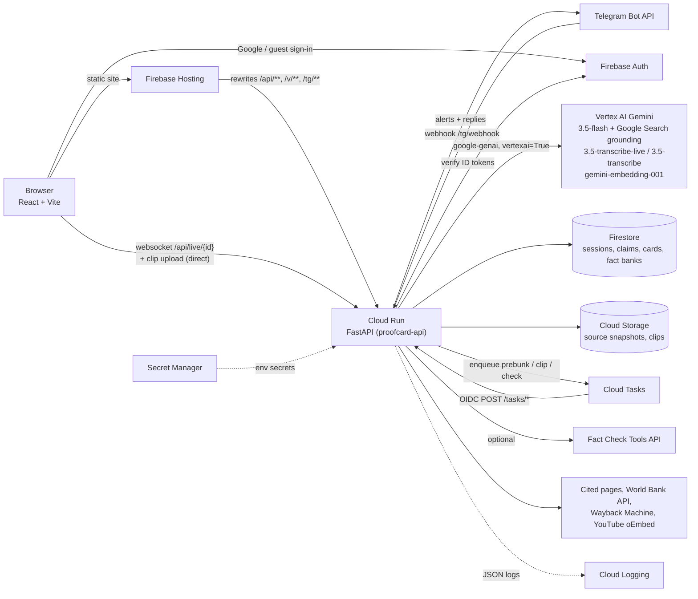
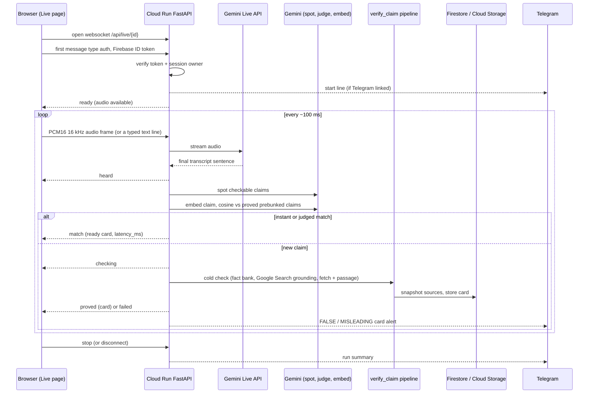

# Proof Card

**Every claim a leader makes, proved or flagged in seconds, with a receipt anyone can verify.**

AI can fake a speech, an anchor or a headline in seconds. Proof Card checks what a politician, a news clip or a forward actually claims against official data, shows the exact passage that decides it, and turns every verdict into a tamper evident card anyone can verify on Telegram. Transcription is only the input: the product is the proof.

**Try it:** [aibuilderscup.web.app](https://aibuilderscup.web.app) · Telegram bot [@ProofCardAgentBot](https://t.me/ProofCardAgentBot) · step-by-step guide + demo script: [`docs/DEMO.md`](docs/DEMO.md)

Google Cloud AI Builder Cup 2026 · Media, Content & Digital Experiences track.



## What it does

Verdicts are always one of **TRUE · MISLEADING · FALSE · UNVERIFIABLE**. No source passage, no hard verdict: the card says UNVERIFIABLE instead of guessing.

### Before the speech: prebunk brief + fact bank
- Paste a **YouTube link** (topic and speaker optional): the title comes from YouTube oEmbed and the publish date anchors research to the figures current on the day of the speech (`backend/app/pipeline.py`).
- **Gemini predicts the claims** likely to come up and checks each one with **Google Search grounding** (`backend/app/model.py`). If a Fact Check Tools API key is set, published fact checks are looked up first (`backend/app/factcheck.py`).
- A **research fact bank** is built for the topic + speaker: a fact is kept only when its page was fetched and a passage on it backs the statement. Official statistics come first (World Bank Indicators API, `backend/app/officialdata.py`; government sources, `backend/app/govsources.py`), and old speeches read the Wayback Machine copy nearest the speech day (`backend/app/facts.py`).
- **We fetch every cited page ourselves**, extract text (trafilatura, PDFs via pypdf), find the passage that supports or contradicts the claim in English, Hindi or Hinglish, and snapshot the exact bytes under their sha256 (`backend/app/proof.py`).

| New brief | Brief + fact bank |
|---|---|
|  |  |

### During: live claim matching
- The browser captures **tab audio** (`getDisplayMedia`, 16 kHz PCM16) and streams it over a websocket to `/api/live/{id}` (`frontend/src/live.ts`), or sends typed transcript lines.
- The backend relays audio to the **Gemini Live API** for transcription, with a vocabulary built from the predicted claims (`backend/app/live.py`).
- Each sentence goes through **claim spotting** (Gemini), then **embedding match** (`gemini-embedding-001`) against the brief's proved claims: a strong match pops the ready card instantly (PREBUNKED), a borderline one asks a Gemini judge, a new claim is checked cold through the same pipeline as Before (LIVE).
- **Telegram auto-alerts:** link Telegram once and every live run reports by itself: a start line, each **FALSE / MISLEADING** card as it is heard (with a YouTube link at that moment), and a summary at the end (`backend/app/alerts.py`).
- **Share a read-only viewer link** so others watch the cards land (`frontend/src/pages/Watch.tsx`).

### After: proof cards + clip replay
- **Recorded clips:** upload the audio (or one click on the sample clip); `gemini-3.5-transcribe` turns it into timed lines, each checked like live speech (`backend/app/clip.py`). **Replay with video** pops each card at the second it was said, in the embedded YouTube player (`frontend/src/pages/Live.tsx`).
- **Shareable Proof Cards:** every card is a PNG with verdict, a one-line why, the source passage, a fingerprint and a QR (`backend/app/card_image.py`), plus a public page at `/v/<id>` (`backend/app/share_page.py`). Anyone can download a source snapshot at `/api/snapshots/<sha256>` and recompute its hash.
- **Tamper check:** forward a card image back to the bot or `/v/<id>`: **VERIFIED**, or **ALTERED** with which part was edited (`backend/app/alter.py`).
- **Claims said in other words reuse a card** already proved this week (`backend/app/reuse.py`).

| Clip replay | Proof Card | All cards |
|---|---|---|
|  |  |  |

### Telegram bot, for anyone ([@ProofCardAgentBot](https://t.me/ProofCardAgentBot))
All in `backend/app/telegram.py`:
- **Plain claims:** send any claim, get the verdict, the source passage and a shareable card.
- **Multi-claim forwards:** a forwarded message is split into up to 3 claims, one numbered verdict each, every reply threaded to the message it answers.
- **Screenshots:** a screenshot of a forward or news graphic is read by Gemini and its claims are checked like typed ones; a Proof Card image is checked for tampering instead.
- **"X said" quotes:** "Modi said '...'" (also `ne kaha ki` / Hindi) is checked as a quote first: is it on record? An unproven quote is never shown as TRUE (`backend/app/quotes.py`).
- Works in groups when mentioned or forwarded to, inline mode, and 40 checks per chat per day.

## Architecture



### Live flow (`/api/live/{id}`)



More detail: [`docs/FLOW.md`](docs/FLOW.md) and [`context/ARCHITECTURE.md`](context/ARCHITECTURE.md).

## Google Cloud & AI products we use

| Product | What for | Where in the code |
|---|---|---|
| **Vertex AI Gemini API** (`google-genai`, `vertexai=True`) | All model calls | `backend/app/model.py` (`vertex_client`), `backend/app/live.py`, `backend/requirements.txt` |
| **Gemini 3.5 Flash** (`gemini-3.5-flash`) | Claim prediction, assessment, claim spotting, same-claim judge, forward splitting, reading screenshots | `backend/app/config.py`, `backend/app/model.py`, `backend/app/live.py` (`VertexSpotter`, `VertexJudge`, `VertexImageReader`), `backend/app/facts.py` |
| **Grounding with Google Search** | Evidence for every claim and fact bank entry | `backend/app/model.py`, `backend/app/facts.py` (`types.GoogleSearch()`) |
| **Gemini Live API** (`gemini-3.5-transcribe-live`) | Live tab audio transcription | `backend/app/live.py` (`GeminiLiveTranscriber`), `backend/app/config.py` |
| **Gemini 3.5 Transcribe** (`gemini-3.5-transcribe`) | Uploaded clip transcription with timestamps | `backend/app/clip.py` (`GeminiClipTranscriber`) |
| **Gemini Embedding** (`gemini-embedding-001`) | Live claim matching, card reuse | `backend/app/live.py` (`VertexEmbedder`), `backend/app/reuse.py` |
| **Google Fact Check Tools API** | Published fact checks first (optional key) | `backend/app/factcheck.py`, `backend/app/main.py` |
| **Cloud Run** | Hosts the FastAPI backend, websockets | `backend/Dockerfile`, `.github/workflows/deploy.yml`, `firebase.json` (rewrites) |
| **Firebase Hosting** | Serves the React app, rewrites `/api`, `/v`, `/tg` to Cloud Run | `firebase.json`, `.github/workflows/deploy.yml` |
| **Firebase Authentication** | Google sign-in + guest (anonymous) on the web, ID token verification on the server | `frontend/src/auth.ts`, `backend/app/auth.py` (`firebase-admin`) |
| **Cloud Firestore** | Sessions, claims, cards, fact banks; deny-by-default rules | `backend/app/store.py`, `firestore.rules`, `firestore.indexes.json` |
| **Cloud Storage** | Source page snapshots (by sha256) and uploaded clips | `backend/app/proof.py` (`GcsSnapshots`), `backend/app/main.py` |
| **Cloud Tasks** | Durable background jobs (prebunk, clip, check) with OIDC callbacks | `backend/app/tasks.py` (`CloudTasksQueue`), `backend/app/main.py` (`/tasks/*`) |
| **Secret Manager** | Telegram token + webhook secret, Fact Check API key injected as env | `backend/app/config.py`, `.github/workflows/deploy.yml` (`--update-secrets`) |
| **Artifact Registry** | API container images | `.github/workflows/deploy.yml` |
| **IAM Workload Identity Federation** | Keyless GitHub Actions deploy | `.github/workflows/deploy.yml` (`google-github-actions/auth`) |
| **Cloud Logging** | Structured JSON logs with PII redaction | `backend/app/logging_setup.py` |
| **BigQuery** | Analytics views + benchmark metrics over exported Firestore data | `sql/*.sql`, `sql/README.md` |
| **Firebase Local Emulator Suite** | Firestore rules tests in CI | `rules-tests/`, `.github/workflows/ci.yml`, `firebase.json` |
| **YouTube** (oEmbed + IFrame Player API) | Video title for the brief, replay with cards at the right second | `backend/app/pipeline.py`, `frontend/src/live.ts`, `frontend/src/pages/Live.tsx` |

## Run locally (no GCP needed)
```bash
cd backend
python -m venv .venv && . .venv/bin/activate
pip install -r requirements.txt -r requirements-dev.txt
cp .env.example .env            # PC_MODEL_MODE=stub, PC_ENV=local
PC_AUTH_DISABLED=true uvicorn app.asgi:app --port 8080   # in memory store, fixture model
pytest                          # ruff, mypy strict and 85% coverage gate run in CI too
python -m bench.run --mode stub # benchmark harness wiring check

cd ../frontend && npm ci && npm run dev   # npm test, npm run build
```
Stub mode uses fixtures and an in memory store: no Google credentials, nothing persisted. Real services: set `PC_MODEL_MODE=vertex` + `PC_GCP_PROJECT` (see `externals/E03` to `E09`).

Firestore rules tests (emulator, needs Java 11+ and Node 20):
```bash
cd rules-tests && npm ci
npx firebase emulators:exec --only firestore --project demo-proofcard --config ../firebase.json "npm test"
```

## Deploy
- **First deploy is manual, once:** Cloud Run service, env vars, secrets, Cloud Tasks queue, Firebase Hosting + rules and the Telegram webhook: [`externals/E09_first_deploy.md`](externals/E09_first_deploy.md). All human setup steps (GCP project, APIs, Firebase, service accounts, Telegram, CI access): [`externals/`](externals/README.md).
- **After that, every merge to `main` deploys itself:** CI green -> [`deploy.yml`](.github/workflows/deploy.yml) authenticates keylessly, builds and pushes the API image to Artifact Registry, deploys it to Cloud Run, checks `/api/health`, builds the frontend and runs `firebase deploy --only hosting,firestore:rules,firestore:indexes`.
- **CI** ([`ci.yml`](.github/workflows/ci.yml)): ruff, mypy, pytest with an 85% coverage gate, pip-audit, Firestore rules tests on the emulator, frontend typecheck + build + tests, npm audit.

## Benchmark
`backend/bench/`: H1 gold set (50 source linked claims, en / hi / hi-Latn) and the H2 runner (accuracy, proof rate, latency p50 / p95, instant match, tamper). Every number we quote comes from a committed run. See [`backend/bench/README.md`](backend/bench/README.md).

## Docs
- How to use + demo script: [`docs/DEMO.md`](docs/DEMO.md)
- Project docs, plans and dev memory: [`context/`](context/00_README.md)
- Where the build is right now: [`context/SNAPSHOT.md`](context/SNAPSHOT.md)

## Credits and licences
Built on open source and Google services; full list with licences in [`NOTICES.md`](NOTICES.md). Fonts: Noto Sans + Noto Sans Devanagari (SIL OFL 1.1, `backend/app/assets/fonts/OFL.txt`).
