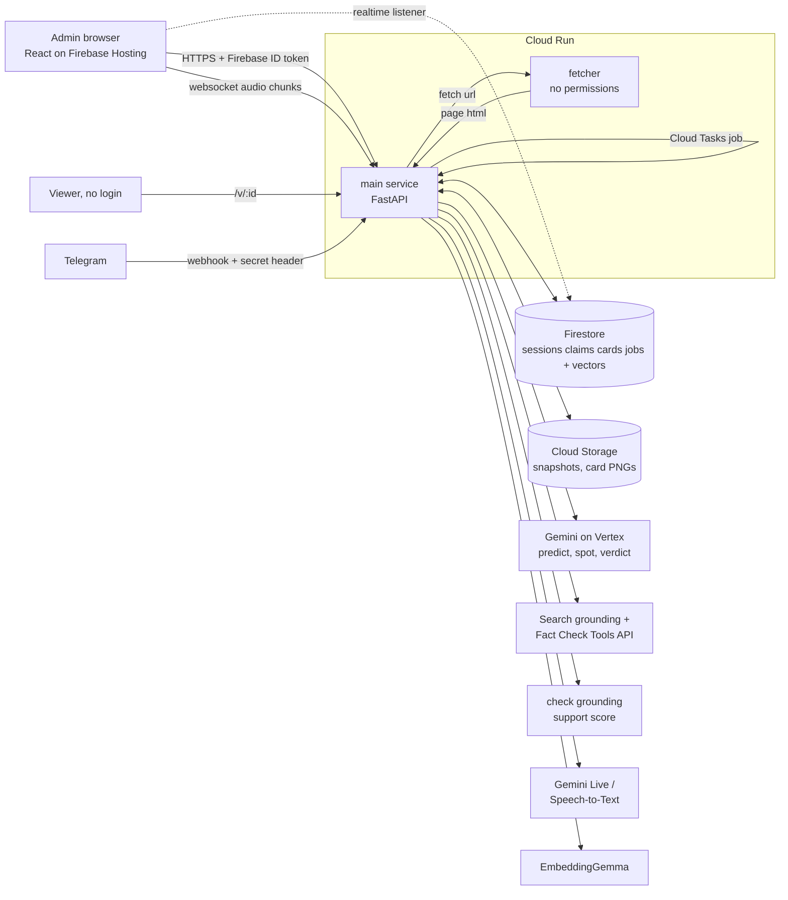

# 03 · Architecture, Integrations, APIs

Labels: ✅ verified · 🟡 inference / design choice.

## 1. Big picture

🔴 Plan diagram. Not built (14 Oct): separate fetcher service, Firestore vectors, check grounding, EmbeddingGemma. As built: `ARCHITECTURE.md` § Data flow and [DECK_TEXT.md](DECK_TEXT.md) slide 8.

## 2. The demo spine, step by step

**Before (Prebunk Brief)**
1. FE: admin submits topic + speaker + optional context links → `POST /api/prebunk`.
2. BE: Gemini predicts 10 to 15 claims as JSON (claim text, language, why likely).
3. BE: for each claim, enqueue a Cloud Task `verify_claim`.
4. MW: `verify_claim` → Fact Check Tools API lookup → if none, Gemini + Search grounding → verdict + cited URLs.
5. MW: check grounding scores the verdict against the source snippets; support below threshold → verdict becomes UNVERIFIABLE 🟡 threshold tuned on benchmark.
6. INT: fetcher pulls each cited URL → trafilatura text → RapidFuzz locates the snippet → snapshot text + sha256 → Cloud Storage `snapshots/<sha256>.txt`.
7. BE: card created (`cards/<id>`), PNG rendered, claim embedded, vector saved.
8. FE: brief page updates live through a Firestore listener (no polling).

**During (live bridge)**
9. FE: admin pastes a YouTube link → IFrame player; clicks "Start listening" → `getDisplayMedia` tab audio → 16 kHz chunks over websocket. Fallback: upload the clip file. 🟡
10. MW: websocket relays audio to Gemini Live transcription (keys stay server side).
11. BE: every final sentence → claim spotting (fast model / langextract) → check worthy?
12. BE: embed sentence → Firestore `find_nearest` against this session's predicted claims.
13. Hit (distance under threshold) → push the existing card instantly. Miss → card with status `checking` → steps 4 to 7 run cold.

**After (Proof Capsule)**
14. Card page `/v/<id>`: verdict, sources, snippet highlighted, snapshot hash, timestamp, "Share on Telegram" button.
15. Share: deep link `t.me/<bot>?start=<id>` and card PNG (id + QR printed on it).
16. Someone forwards the PNG (maybe edited) to the bot.
17. Bot: download via `getFile` (≤20 MB ✅) → read id from QR (fallback: Gemini vision reads the printed id) → load canonical card.
18. Compare: Gemini vision extracts the visible verdict + claim text; text diff vs canonical; pHash distance vs issued PNG.
19. Reply: ✅ VERIFIED or ⚠️ ALTERED (what changed) + "Open proof" URL button.

🔴 Hard truth on step 18: Telegram and WhatsApp recompress photos, so a byte level sha256 of the image will **never** match after a forward 🟡 (standard behaviour of "send as photo"). sha256 protects the **source snapshot** and the **canonical card record**; the ALTERED check on images must be text diff + perceptual hash. Pitch it exactly like that or a technical judge will catch it.

## 3. Internal API (main service)

| Method | Path | Auth | Purpose |
|---|---|---|---|
| POST | `/api/prebunk` | Firebase ID token + App Check | create session + predicted claims |
| GET | `/api/sessions/:id` | owner | session state (UI mostly uses Firestore listener) |
| WS | `/ws/live/:session` | ID token in first message | audio in, events out |
| POST | `/api/live/upload/:session` | owner | clip upload fallback |
| POST | `/tasks/verify_claim` | Cloud Tasks OIDC | grounded check + proof |
| GET | `/v/:card_id` | public | verify page (SSR HTML + OG image) |
| GET | `/card/:card_id.png` | public | card image |
| POST | `/api/check` | public, rate limited | paste text or upload image → VERIFIED / ALTERED |
| POST | `/tg/webhook` | header `X-Telegram-Bot-Api-Secret-Token` ✅ [Bot API setWebhook](https://core.telegram.org/bots/api#setwebhook) | bot updates |

## 4. Firestore data model

| Collection | Key fields |
|---|---|
| `sessions/{id}` | owner_uid, topic, speaker, youtube_url, status, created_at |
| `sessions/{id}/claims/{id}` | text, lang, source: predicted / live, embedding (vector), card_id, status: queued / checking / proved / failed |
| `cards/{id}` | claim, verdict (TRUE, MISLEADING, FALSE, UNVERIFIABLE), explanation, sources[{url, snippet, snapshot_sha256, fetched_at}], support_score, card_sha256, png_phash, created_at |
| `tg_checks/{id}` | chat_id hash, card_id, result, diff, created_at |

`card_sha256` = sha256 of the canonical card JSON at issue time; any server side edit would break it 🟡.

## 5. External integrations

| Integration | What we call | Limits / gotchas | Source |
|---|---|---|---|
| Gemini on Vertex | generateContent with JSON schema; tools: Google Search | grounding has per minute quota 🟡 check console | ✅ [grounding docs](https://docs.cloud.google.com/vertex-ai/generative-ai/docs/model-reference/grounding) |
| check grounding | answer + facts → support score | region availability 🟡 | ✅ [docs](https://docs.cloud.google.com/generative-ai-app-builder/docs/check-grounding) |
| Fact Check Tools API | `claims:search` | coverage of Hindi claims may be thin 🟡 | ✅ [docs](https://developers.google.com/fact-check/tools/api) |
| Gemini Live transcription | streaming audio in | session length limits 🟡 check docs on Oct 14 | ✅ [docs](https://ai.google.dev/gemini-api/docs/live-api/live-transcribe) |
| Firestore vector search | `find_nearest` | needs a vector index created up front | ✅ [docs](https://firebase.google.com/docs/firestore/vector-search) |
| Telegram Bot API | setWebhook, sendPhoto, sendMessage, getFile, inline keyboard | 1 msg/s per chat, 20/min per group, photos 10 MB, files 50 MB, download 20 MB ✅ | ✅ [api](https://core.telegram.org/bots/api), [faq](https://core.telegram.org/bots/faq) |
| YouTube IFrame API | embed + playback events | we never scrape captions server side | ✅ [docs](https://developers.google.com/youtube/iframe_api_reference) |

## 6. Security

- Fetcher: own service account with zero IAM roles, block private IP ranges, size + time limits 🟡.
- Fetched page text is untrusted: wrap as data in prompts; Model Armor if time 🟡.
- Public endpoints (`/api/check`, `/tg/webhook`) rate limited; App Check on browser calls.
- Secrets in Secret Manager; nothing in the public repo (repo must be public ✅ submission rules).
