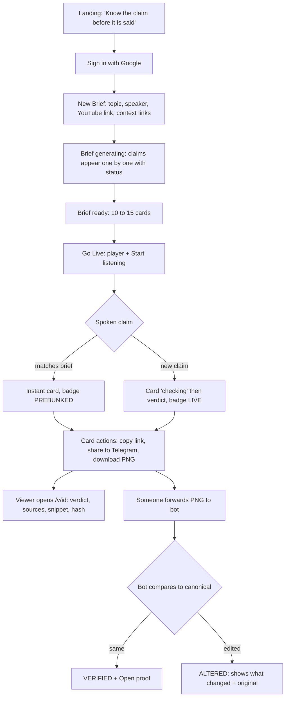

# 04 · User Flow + Screen Flow

Labels: 🟡 = design choice (all of this doc is design, nothing external to verify unless linked).

## 1. Personas in the flow

- **Admin** (logged in): prepares the brief, runs the live session, shares cards.
- **Viewer** (no login): opens a card link or forwards a card to the bot.

## 2. User flow

## 3. Screens (7 total, 4 must)

| # | Screen | Must? | Key elements | Empty / error state |
|---|---|---|---|---|
| S1 | Landing | 🔴 | one line pitch, 10 s looping demo GIF, "Try with sample" + "Sign in" | none |
| S2 | New Brief | 🔴 | topic (required), speaker, YouTube URL, up to 3 context links, language chips (Auto / हिंदी / English / Hinglish), "Generate brief" | validation inline; "try sample topic" link |
| S3 | Brief (Before) | 🔴 | progress "7 of 12 checked", claim cards grid with verdict pill, support score, source count; "Go live" button | a claim fails → card shows UNVERIFIABLE with reason, never a blank |
| S4 | Live (During) | 🔴 | left: YouTube player; right: live card feed newest on top; top bar: listening indicator + latency chip ("0.8 s, prebunked"); captions strip | mic/tab permission denied → "upload clip instead" |
| S5 | Card / Verify page `/v/:id` | 🔴 | big verdict, claim, 2 line why, sources with highlighted snippet, "Proof" drawer (snapshot hash, fetched time), "Check a forwarded copy" upload, share buttons | unknown id → "No such card. If someone sent you this, treat it as fake." |
| S6 | Check result | 🟡 | VERIFIED (green) or ALTERED (red) with side by side diff of changed words | low confidence → "Could not read the image, open the original link" |
| S7 | Benchmark page `/about` | 🟢 | accuracy, latency chart, method, team | |

## 4. Telegram flow (bot)

| Step | User does | Bot replies |
|---|---|---|
| 1 | taps "Share on Telegram" on a card | Telegram opens `t.me/<bot>?start=<id>`; bot sends card PNG + buttons [Open proof] [Share] |
| 2 | taps [Share] | `switch_inline_query` lets them pick a chat ✅ [Bot API](https://core.telegram.org/bots/api#inlinekeyboardbutton) (stretch: needs inline mode) |
| 3 | forwards any card image to the bot | "Checking..." then ✅ VERIFIED or ⚠️ ALTERED: "verdict changed from FALSE to TRUE" + [Open original] |
| 4 | sends text instead of image | bot matches against cards by vector search, returns the closest card or "no card found" |
| 5 | `/help` | 3 lines, how to check a card |

## 5. The 3 minute video storyboard (screen order)

| Time | Shot | Screen |
|---|---|---|
| 0:00 to 0:25 | Hook: speaker says false claim, card pops instantly with PREBUNKED + "0.6 s" | S4 |
| 0:25 to 0:45 | The problem in 2 lines + who it's for | slide |
| 0:45 to 1:20 | How: create brief, claims verified with sources before the stream | S2, S3 |
| 1:20 to 1:50 | Live: one prebunked hit, one cold claim checking then verdict | S4 |
| 1:50 to 2:25 | After: forward card to Telegram, edited copy → ALTERED | Telegram + S6 |
| 2:25 to 2:45 | Proof drawer: snippet + hash; architecture in one frame naming Gemini, Firebase, Firestore, Cloud Run | S5 + diagram |
| 2:45 to 2:58 | Benchmark numbers + close | S7 |

🔴 Never fake the live hit: record the real system. A judge spotting a staged demo kills Tech score. 🟡
